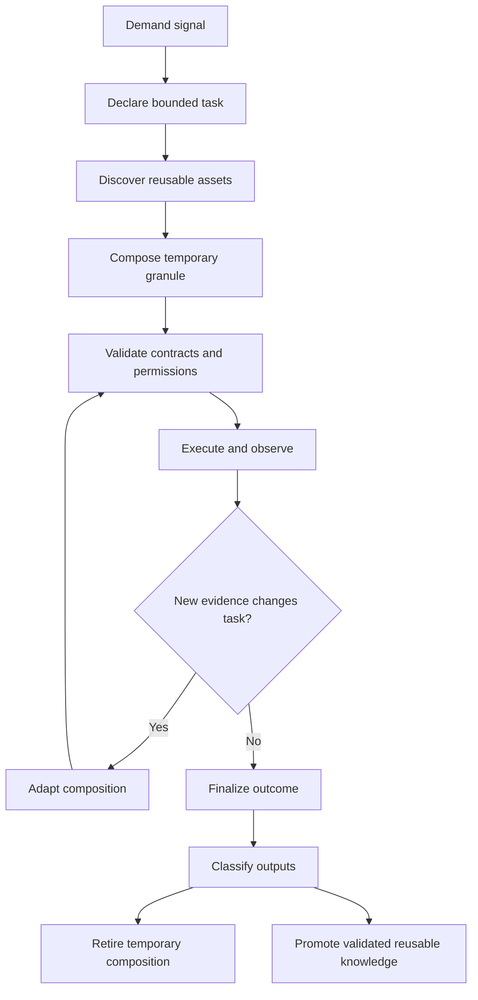

# Dynamic Granule Lifecycle: A Minimal Example

This example abstracts a recurring engineering situation: a changing demand signal requires a short-lived combination of capabilities. It is illustrative, not a disclosure of production data, platform methods, credentials, or internal paths.

## Scenario

A demand signal appears in a bounded category and time window. The system needs to gather evidence, classify the signal, compare candidate items, and produce a decision brief. The exact sequence is not fixed in advance.

## Lifecycle

## What persists and what dissolves?

| Candidate | Default decision | Reason |
|---|---|---|
| Verified data connector | Persist as governed capability | Reusable beyond one task |
| Generic parser or validator | Persist if independently tested | Reusable capability |
| Task-specific execution graph | Retire | Exists to serve this task |
| Temporary query and bindings | Retire or retain only as permitted evidence | Often task-specific |
| Raw intermediate data | Retain only under an explicit data policy | May be sensitive, redundant, or short-lived |
| Final decision and provenance | Retain according to audit policy | Explains the outcome |
| Newly inferred rule | Quarantine pending validation | One observation is not a reusable rule |

## Design questions

1. What is the smallest unit that should be treated as a reusable asset?
2. Which changes justify rebuilding a granule instead of adapting it?
3. What evidence is sufficient to promote a discovered rule?
4. How should a system prove that temporary credentials and task-local state were retired?
5. How can the system preserve reproducibility without preserving every transient artifact?

## Boundary

The example does not claim that dynamic composition is always better. Stable, repetitive workloads may be more efficiently served by fixed workflows. The purpose is to make the lifecycle trade-off explicit and testable.
